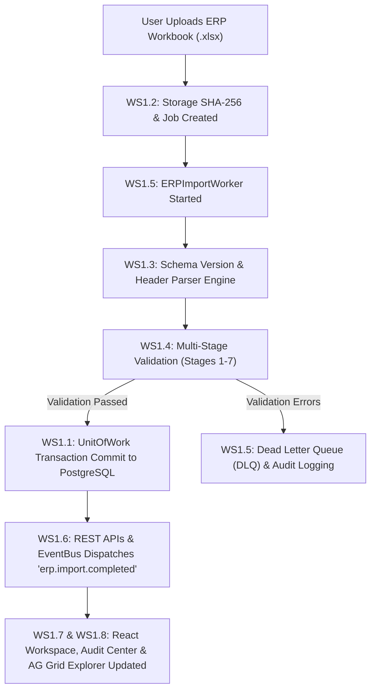

# Phase 1 Master Implementation Blueprint
## ERP Operational Data Platform & Import Workspace

**Project Name:** Fleet Control Tower & Operational Intelligence Platform  
**Governing Architecture:** Master Architecture Blueprint v1.0.0 (FROZEN)  
**Phase:** Phase 1 — ERP Operational Data Platform & Import Workspace  
**Document Version:** v2.0.0 (APPROVED PRODUCTION MASTER BLUEPRINT)  
**Blueprint Status:** AWAITING FINAL ARCHITECTURE SIGN OFF  

---

## 1. Executive Vision & Business Purpose

### 1.1 Executive Vision
Establish the canonical ERP Operational Data Platform as the single source of operational truth for the entire Fleet Control Tower. Phase 1 delivers a streaming Excel parsing engine, dynamic schema/version detection, multi-stage validation, transaction-safe database persistence, comprehensive audit logging, REST APIs, and an enterprise dark-glassmorphism React Import Workspace featuring real-time pipeline visualization, operational KPI cards, an AG Grid Data Explorer & Audit Center, and an Automated Verification Panel.

### 1.2 Business Purpose
Every future vertical module (Dispatch Analysis, Timeline Replay, Operational Intelligence, Continuous Learning AI, Reports, and Executive Dashboards) will consume operational entities produced by Phase 1. No raw telemetry or operational calculations may bypass this canonical ERP pipeline.

---

## 2. ERP Module Ownership & Architecture Contract

### 2.1 ERP Vertical Slice Module Ownership
```text
ERP Module Root

backend/
└── app/
    └── modules/
        └── erp/
            ├── api/          # FastAPI v1 endpoints & routers
            ├── models/       # SQLAlchemy canonical & ingestion models
            ├── repositories/ # Async generic & specialized repositories
            ├── services/     # Parser, storage, job, mapping, validation services
            ├── workers/      # ERP background import workers & job processors
            ├── schemas/      # Pydantic DTOs & response schemas
            ├── events/       # ERP domain events & schema definitions
            ├── storage/      # File storage manager & SHA-256 checksums
            ├── validation/   # Multi-stage validation engines
            ├── mapping/      # Header mapping & alias dictionaries
            ├── parsers/      # Streaming Excel parsing engines
            ├── telemetry/    # Ingestion worker performance telemetry
            └── tests/        # Pytest unit, integration, & worker tests

frontend/
└── src/
    └── modules/
        └── erp/
            ├── api/          # Axios API endpoints for ERP module
            ├── pages/        # ImportWorkspacePage & DataExplorerPage
            ├── components/   # UploadWorkspace, ProgressDrawer, KPIContainer
            ├── hooks/        # ERP custom hooks (useERPProgress, useERPAudit)
            ├── store/        # Zustand ERP slice
            ├── routes/       # ERP module route definitions
            ├── types/        # ERP TypeScript interfaces
            ├── services/     # ERP frontend serializers
            ├── utils/        # ERP-specific formatters
            └── tests/        # Vitest & Testing Library test suites
```

---

## 3. Frontend Design Contract (FROZEN)

> [!IMPORTANT]
> **OFFICIAL FRONTEND DESIGN CONTRACT**:  
> The ERP Import Workspace implemented in WS1.7 and WS1.8 MUST strictly follow the approved Fleet Control Tower enterprise control-room visual language.
> 
> * **Identical dark glassmorphism theme** established in Phase 0.
> * **Left operational navigation sidebar** identical to platform shell.
> * **Top operational toolbar** with slot architecture for ERP status.
> * **Compact KPI cards** with high-density spacing.
> * **High-density operational AG Grid tables** and status chips.
> * **Responsive Desktop, Tablet, and Mobile layouts**.
> * **Modular React architecture** with isolated ERP components.
> * **No redesign of the approved visual language** without architecture approval.

---

## 4. Phase 1 End-to-End Ingestion Flow



---

## 5. Workstream Sequence Breakdown & Comprehensive Roadmap

```
PHASE 1 — ERP Operational Data Platform & Import Workspace

⬜ WS1.1 ERP Database & Canonical Data Foundation
⬜ WS1.2 Workbook Storage & Import Job Management
⬜ WS1.3 Excel Parser & Dynamic Workbook Engine
⬜ WS1.4 Canonical Mapping & Validation Engine
⬜ WS1.5 Background Import Pipeline & Event Processing
⬜ WS1.6 ERP REST APIs & Import Management
⬜ WS1.7 ERP Import Workspace (Frontend)
⬜ WS1.8 Imported Data Explorer & Audit Center
⬜ WS1.9 End-to-End Integration, Performance Testing & Phase 1 Certification
```

---

### WS1.1 — ERP Database & Canonical Data Foundation
* **Backend Responsibilities**:
  * Define SQLAlchemy Canonical Models: `Plant`, `Site`, `Customer`, `Material`, `Product`, `Vehicle`, `Driver`, `Route`, `Order`, `Ticket`, `Dispatch`, `Invoice`, `Trip`.
  * Define Ingestion Metadata Models: `ImportJob`, `WorkbookMetadata`, `ImportAuditLog`, `ImportStatistic`, `ImportStage`, `ImportError`, `ImportWarning`, `ImportFile`, `ImportCheckpoint`, `ImportPerformanceMetrics`, `ImportEvent`.
  * **Database Indexing & Constraints**:
    * Single & composite indexes e.g., `Dispatch` (`dispatch_number`, `ticket_number`, `plant_id`, `dispatch_date`), composite index `(plant_id, dispatch_date)` & `(customer_id, dispatch_date)`. Unique constraint on `dispatch_number`.
    * Foreign key cascade policies (`ON DELETE RESTRICT` for canonical entities).
  * Repositories and Alembic migration scripts.
* **Testing & Quality**: Unit tests, index performance tests, migration rollforward/rollback tests.
* **Manual Verification Guide**: Database table schema inspection, index verification commands, count checks.
* **Production Checklist**: Static analysis, unit tests, integration tests, DB verification, ready for review.

---

### WS1.2 — Workbook Storage & Import Job Management
* **Backend Responsibilities**:
  * Chunked, resumable file upload & storage manager (`storage/storage.py`) computing SHA-256 checksums.
  * Resumable upload hashing allowing interrupted uploads to resume seamlessly.
  * `ImportJobService` managing state machine (`QUEUED` ➔ `RUNNING` ➔ `COMPLETED` / `FAILED` ➔ `DLQ`).
  * Cancel, Retry, and Resume job API primitives.
* **Testing & Quality**: Checksum collision tests, upload storage cleanup tests, state machine boundary tests.
* **Manual Verification Guide**: File upload chunk validation, resume upload test commands.
* **Production Checklist**: Static analysis, unit tests, storage verification, ready for review.

---

### WS1.3 — Excel Parser & Dynamic Workbook Engine
* **Backend Responsibilities**:
  * Memory-efficient streaming Excel parser reading rows in batches.
  * **Multi-Tier Version Detection**: Automatic detection of `Workbook Version`, `Sheet Version`, and `Schema Version` (handling `Schema v1`, `Schema v2`, `Schema v3` across different plants).
  * Dynamic sheet auto-discovery and fuzzy header matching (normalizing aliases e.g., `"Ticket No."`, `"Ticket_ID"`, `"TicketNum"`).
* **Testing & Quality**: Large 100k+ row benchmark tests (`< 512MB RAM`), schema v1/v2/v3 detection tests.
* **Manual Verification Guide**: Parser CLI dry-run, schema version detection verification.
* **Production Checklist**: Static analysis, parser tests, RAM profile check, ready for review.

---

### WS1.4 — Canonical Mapping & Validation Engine
* **Backend Responsibilities**:
  * **7-Stage Validation Pipeline**:
    * `Stage 1`: Workbook Validation
    * `Stage 2`: Sheet Validation
    * `Stage 3`: Header Validation
    * `Stage 4`: Row Validation
    * `Stage 5`: Cross-Sheet Validation
    * `Stage 6`: Business Validation
    * `Stage 7`: Database Validation
  * Atomic UnitOfWork transaction rollback on failure.
* **Testing & Quality**: Unit tests for validation stages 1-7, duplicate isolation tests.
* **Manual Verification Guide**: Validation engine dry-run script with error injection.
* **Production Checklist**: Static analysis, validation tests, rollback check, ready for review.

---

### WS1.5 — Background Import Pipeline & Event Processing
* **Backend Responsibilities**:
  * `ERPImportWorker` extending `BackgroundWorker` interface (`start()`, `stop()`, `heartbeat()`).
  * **Operational Progress Telemetry**: Exposing `current_stage`, `current_sheet`, `rows_per_sec`, `estimated_finish_sec`, `current_batch`, `memory_usage_mb`, `cpu_usage_pct`.
  * Integration with WS0.5 `RetryPolicy` and `DeadLetterQueue`.
* **Testing & Quality**: Worker failure recovery tests, telemetry metric collection tests.
* **Manual Verification Guide**: Worker heartbeat & telemetry stream inspection.
* **Production Checklist**: Static analysis, worker tests, telemetry check, ready for review.

---

### WS1.6 — ERP REST APIs & Import Management
* **Backend Responsibilities**:
  * FastAPI Versioned API (`/api/v1/erp/`): Upload, History, Audit, Statistics, Job Details, Progress SSE Stream, Cancellation, and Retry APIs.
  * Rate limits, OpenAPI tags, cursor pagination, filtering, sorting, idempotency header validation (`X-Idempotency-Key`).
* **Testing & Quality**: FastAPI TestClient integration tests, auth claim checks, 100% parameter validation tests.
* **Manual Verification Guide**: OpenAPI Swagger UI inspection, cURL API requests.
* **Production Checklist**: Static analysis, API tests, OpenAPI check, ready for review.

---

### WS1.7 — ERP Import Workspace (Frontend)
* **Frontend Responsibilities**:
  * Desktop, Tablet, and Mobile responsive React application under `src/modules/erp/`.
  * Page Structure: Header, Filters, KPI Cards, Upload Workspace, Pipeline Progress, Live Progress Drawer, Import Timeline, Worker Status, Validation Feed, Error Feed, Current Stage Details, Import Controls, Footer.
  * Real-time progress visualization with estimated finish, elapsed time, current stage, and worker metrics.
* **Testing & Quality**: Vitest component tests for upload triggers, progress bar animation updates, accessibility role checks.
* **Manual Verification Guide**: UI interactive upload test, drawer toggle test, responsive breakpoint test.
* **Production Checklist**: Vitest, React Testing Library, ESLint, TypeScript strict, ready for review.

---

### WS1.8 — Imported Data Explorer & Audit Center
* **Frontend Responsibilities**:
  * **ERP Audit Center**: Import History, Audit Logs, Validation Logs, Worker Logs, Performance Metrics, Import Statistics, Failed Imports, Warning Center, Retry Queue, Export Audit.
  * **Data Explorer**: AG Grid Enterprise-grade table supporting `Dispatches`, `Invoices`, `Customers`, `Plants`, `Sites`, `Vehicles`, `Drivers`, `Routes`, `Materials`, `Orders`, `Tickets`, `Trips`.
  * AG Grid features: Search, filtering, sorting, column chooser, CSV export, pagination, virtual scrolling, sticky headers.
* **Testing & Quality**: AG Grid rendering tests, Audit Center tab toggle tests.
* **Manual Verification Guide**: AG Grid filtering/export test, Audit Center log inspection.
* **Production Checklist**: Vitest, AG Grid render test, responsiveness check, ready for review.

---

### WS1.9 — End-to-End Integration, Performance Testing & Phase 1 Certification
* **Platform Audit Responsibilities**:
  * Full integration test across WSL Linux, PostgreSQL, Redis, FastAPI, and React frontend.
  * Benchmark: 100,000 row Excel file imported in `< 30 seconds` with `< 512MB` Peak RAM.
  * Complete Phase 1 Signoff and freeze.
* **Manual Verification Guide**: End-to-end import run, database count verification.
* **Production Checklist**: Final quality gates, 100% test pass, certification.

---

## 6. Definition of Done & Exit Criteria

- [ ] Master Blueprint `PHASE_1_MASTER_IMPLEMENTATION_BLUEPRINT.md` v2.0.0 reviewed & approved.
- [ ] WS1.1 through WS1.9 implemented sequentially.
- [ ] Each workstream verified against static analysis, unit tests, manual verification guide, and production checklist.
- [ ] Phase 1 certified and frozen.
