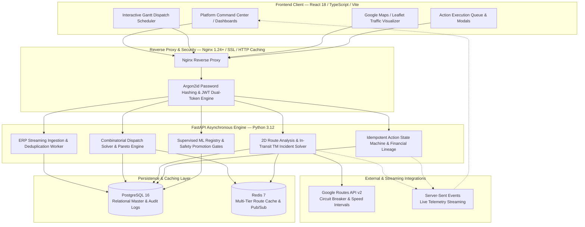
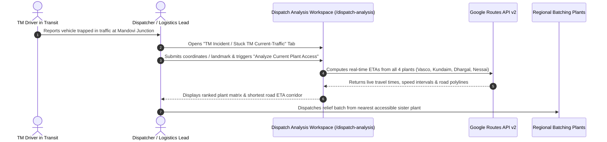

# Fleet Control Tower — Ready-Mix Concrete Logistics & Operational Intelligence Platform

[](https://192.46.210.48/demo-fleet)
[](https://python.org)
[](https://fastapi.tiangolo.com)
[](https://react.dev)
[](https://www.typescriptlang.org)
[](https://www.postgresql.org)
[](https://redis.io)
[](https://nginx.org)

An enterprise-grade, full-stack operational intelligence and decision-support platform engineered specifically for **Ready-Mix Concrete (RMC) multi-plant logistics**. The platform solves the critical operational challenge of **concrete perishability** (the 90–120 minute hydration window) by replacing static post-hoc spreadsheets with **proactive schedule optimization, 2D Google Routes traffic synthesis, in-transit incident reachability analysis, and closed-loop dispatcher action workflows**.

Deployed live on Linux (Ubuntu 24.04 / Linode) with automated zero-downtime deployment pipelines, Nginx reverse proxy routing, and hardened JWT/Argon2id role-based access controls.

---

## Architecture Overview



---

## Key Engineering Capabilities

### 1. High-Throughput Canonical Ingestion & Streaming Deduplication
* **Multi-Format Workbook Processing:** Ingests complex commercial ERP workbooks (`.xlsx`, `.xlsm`, `.xls`, `.csv`) through chunked asynchronous stream readers via `openpyxl` and streaming CSV decoders.
* **Cryptographic Deduplication:** Calculates real-time streaming SHA-256 checksums to enforce strict data provenance and prevent duplicate dispatch processing across multi-plant batches.
* **Canonical Relational Modeling:** Normalizes raw dispatches into a 5-stage temporal delivery lifecycle:
  * **T₁:** Outbound transit duration (Plant &rarr; Jobsite)
  * **T₂ₐ:** Site gate queue holding delay (Baseline SLA: &le; 20 min)
  * **T₂ᵦ:** Concrete discharge & pour duration (Baseline SLA: &le; 60 min)
  * **T₂꜀:** Plant departure detention delay (Baseline SLA: &le; 10 min)
  * **T₃:** Empty vehicle return transit (Jobsite &rarr; Plant)

### 2. Combinatorial Dispatch Schedule Optimization (Pareto Solver)
* **Mathematical Solver Engine (`solver_engine.py`):** Evaluates multi-plant dispatch sequences and simulates departure pacing adjustments without requiring fleet expansion.
* **Pareto Non-Domination Ranking (`pareto_engine.py`):** Simultaneously optimizes conflicting operational criteria:
  > **Pareto Dominance Criterion:** Candidate schedule **A** dominates **B** ($A \succ B$) if and only if for all objectives $i$, $(A_i \ge B_i)$ and for at least one objective $i$, $(A_i > B_i)$.
  
  Evaluates 3 deterministic candidate policies: `BALANCED_OPERATIONS`, `MINIMIZE_DELAY`, and `MAXIMIZE_SLA`.
* **Multi-Plant Boundary Isolation:** Strictly isolates operational truck fleets per plant origin (e.g., `ACC_VASCO`, `ACC_KUNDAIM`, `ACC_DHARGA`, `ACC_NESSAI`), enforcing zero illegal cross-plant vehicle transfers.
* **Interactive Dispatch Gantt Scheduling:** Renders fine-grained **+5-minute staggered departure shifts** (`+5m shift`) in an interactive React timeline with explicit algorithmic rationale ("Why?" triggers).

### 3. Integrated 2D Google Routes Traffic Synthesis & Speed Intervals
* **Google Routes API v2 Client (`google_routes_client.py`):** Features an enterprise rolling-window **Circuit Breaker** (trips at $\ge 50\%$ failure rate with 60s cooldown) and multi-tier Redis caching to eliminate upstream timeout cascades and prevent duplicate API costs.
* **Granular Speed Category Decoders:** Decodes route polylines into discrete road-segment speed intervals:
  * `NORMAL` (Green): Free-flowing highway speeds
  * `SLOW` (Amber): Moderate road deceleration
  * `TRAFFIC_JAM` (Red): Severe corridor bottlenecking
* **2D Synthesis Engine:** Cross-references live Google travel-time estimates against historical mixer truck transit telemetry ($T_1$) to identify true transit variance before concrete is batched into the drum.

### 4. In-Transit "TM Incident / Stuck TM" Decision Support
* **Real-Time Operational Course Correction:** When a mixer truck in transit encounters an unpredicted bottleneck, road accident, or mechanical breakdown, dispatchers toggle to the dedicated **TM Incident Decision Support Workspace**.
* **4-Plant Shortest-ETA Solver:** Accepts operator-reported coordinates or landmark references (e.g., *Panaji City Center / Mandovi Junction*) and dynamically evaluates live Google Routes access times across **all 4 regional batching plants**.
* **Immediate Mitigation:** Ranks candidate sister plants by shortest road travel time in live traffic, enabling dispatchers to re-route vehicles or dispatch relief batches before concrete sets in the stuck drum.




### 5. Closed-Loop Action Workflow & Governed Financial Lineage
* **State Machine Lifecycle (`action_execution_service.py`):** Governs dispatcher directives through an auditable progression:
  > `PENDING` &rarr; `ACCEPTED` &rarr; `IN_PROGRESS` &rarr; `EXECUTED` *(or `REJECTED` / `DEFERRED`)*
* **Idempotency & Concurrency:** Protected by unique UUID idempotency keys, version-locking (`version_lock`), and explicit role-based authorization (Dispatcher, Supervisor, Admin).
* **Governed Financial Formulas:**
  * **Delay Loss Exposure:** `Excess Delay (mins) × ₹25.00/min`
  * **Turnaround Exposure:** `Excess Turnaround (mins) × ₹30.00/min`
  * **Idle Diesel Loss:** `Excess Holding (mins) × 0.05 L/min × ₹95.94/L`
* **Qualitative Safety Controls (`SLA Buffer`):** When dispatches represent non-monetary operational directives (e.g., priority elevation) or lack complete ERP rate tables, the UI displays `SLA Buffer` rather than inventing unverified financial loss.

### 6. Supervised ML Training Pipelines & Enterprise Safety Gates
* **Model Families Implemented:** Built in Scikit-Learn (Random Forest regressors & classifiers):
  * `delay_regressor`: Forecasts transit holding delay ($T_{2a}$)
  * `turnaround_regressor`: Forecasts full round-trip cycle time
  * `sla_breach_classifier`: Predicts customer SLA breach likelihood
  * `plant_risk_classifier`: Predicts batching plant yard congestion
* **Automated Safety Gate (`InferenceSafetyGateService`):** Evaluates candidate models against strict validation holdout thresholds. When historical ERP timestamp noise yields sub-threshold metrics (e.g. negative holdout $R^2$), the gate **withholds production promotion**, setting authority to `NOT_CONFIGURED / CANDIDATE`.
* **Snapshot Traceability:** Stores immutable prediction snapshots (`ml_prediction_snapshots`) with full model lineage, feature inputs, and artifact SHA-256 hashes accessible in the UI.

---

## Production Technology Stack

| Layer | Technologies & Frameworks Used |
|---|---|
| **Frontend Architecture** | React 18.3, TypeScript 5.5, Vite 5.4, Tailwind CSS 3.4, Zustand 4.5, React Router 6.26, Axios, Lucide React |
| **Backend Architecture** | Python 3.12, FastAPI 0.115, Async SQLAlchemy 2.0, Asyncpg 0.29, Pydantic v2, OpenPyXL, Uvicorn (ASGI) |
| **Databases & Caching** | PostgreSQL 16 (Connection Pooling, Indexing), Redis 7 (Multi-Tier Caching, Circuit Breaker State) |
| **Optimization & Data Science** | NumPy, Pandas, Scikit-Learn 1.5, Joblib, Custom Combinatorial Optimization & Pareto Dominance Engine |
| **Spatial & Cloud APIs** | Google Maps Platform (Routes API v2, Maps JavaScript SDK), Leaflet / Polyline Decoders |
| **DevOps & Infrastructure** | Linux (Ubuntu 24.04 LTS), Nginx 1.24+, Systemd Services, Alembic (Async Migrations), Bash CI/CD Scripts |
| **Security & Authentication** | JWT Dual-Token Architecture (HS256), Argon2id Password Hashing, RBAC Matrix, CORS Middleware |

---

## Repository Structure

```text
/home/sanjana/demo-fleet/
├── backend/
│   ├── app/
│   │   ├── core/                    # Security, database sessions, Redis client, logging, base config
│   │   ├── dependencies/            # FastAPI auth guards, DB session injection, RBAC permissions
│   │   ├── modules/
│   │   │   ├── auth/                # JWT issuance, Argon2id hashing, user management routers
│   │   │   ├── erp/                 # Workbook uploaders, CSV parsers, persistence workers
│   │   │   ├── operational_dashboard/
│   │   │   │   └── widgets/
│   │   │   │       ├── alerts/      # Anomaly evaluation rules engine (SHA-256 canonical fingerprints)
│   │   │   │       ├── dispatch_analysis/     # Google Routes v2 client, 2D synthesis, TM incident solver
│   │   │   │       └── dispatch_optimization/ # Solver engine, Pareto non-domination scoring
│   │   │   ├── operational_intelligence/      # Action execution state machine, ML registry & safety gates
│   │   │   ├── reports/             # Asynchronous XLSX & PDF rendering engine
│   │   │   ├── settings/            # Centralized parameter management (diesel rates, SLA baselines)
│   │   │   └── site_dashboard/      # Fleet utilization, hourly dispatch curves, site-level analytics
│   │   └── schemas/                 # Pydantic v2 request/response envelope schemas
│   ├── alembic/                     # Asynchronous database schema migration scripts
│   └── alembic.ini
├── frontend/
│   ├── src/
│   │   ├── api/                     # Axios API clients, Bearer token injectors, error interceptors
│   │   ├── auth/                    # Protected route wrappers, login pages, session guards
│   │   ├── components/              # Shared UI components, KPI cards, visual indicators
│   │   ├── config/                  # Environment bindings, API endpoint constants
│   │   ├── layouts/                 # AppLayout, sidebar navigation, header status bars
│   │   ├── modules/                 # Modular page implementations (Home, Dispatch, Optimization, Intelligence)
│   │   ├── router/                  # Protected and public React Router configuration
│   │   └── store/                   # Zustand authentication and global filter state stores
│   ├── index.html
│   ├── package.json
│   └── vite.config.ts
├── models/ml/                       # Serialized Joblib candidate models and evaluation metadata
└── scripts/
    └── deploy_remote.sh             # Production Linux/Nginx automated deployment pipeline
```

---

## Production Deployment & Infrastructure

The application is deployed to an Ubuntu 24.04 LTS production environment behind an Nginx reverse proxy.

### 1. Nginx Reverse Proxy Configuration
```nginx
# Demo Fleet Platform Proxy Configuration
location = /demo-fleet {
    return 301 /demo-fleet/;
}

# SPA Frontend Distribution & Strict Cache Invalidation
location ^~ /demo-fleet/ {
    alias /opt/apps/demo-fleet/frontend/dist/;
    index index.html;
    try_files $uri $uri/ /demo-fleet/index.html;
    expires -1;
    add_header Cache-Control "no-store, no-cache, must-revalidate, max-age=0" always;
}

# Hashed Static Assets
location /demo-assets/ {
    alias /opt/apps/demo-fleet/frontend/dist/assets/;
    expires -1;
    add_header Cache-Control "no-store, no-cache, must-revalidate";
}

# FastAPI Backend Proxy with Real-Time Streaming Support
location ^~ /demo-api/v1/ {
    proxy_pass http://127.0.0.1:8020/fleet-api/v1/;
    proxy_http_version 1.1;
    proxy_set_header Host $host;
    proxy_set_header X-Real-IP $remote_addr;
    proxy_set_header X-Forwarded-For $proxy_add_x_forwarded_for;
    proxy_set_header X-Forwarded-Proto $scheme;

    # Support Server-Sent Events (SSE) streaming without proxy buffering
    proxy_set_header Connection '';
    proxy_buffering off;
    proxy_cache off;
    chunked_transfer_encoding off;
    proxy_read_timeout 86400s;
}
```

### 2. Systemd Service Unit (`demo-fleet-backend.service`)
```ini
[Unit]
Description=Demo Fleet Control Tower Backend Service (FastAPI)
After=network.target postgresql.service redis.service

[Service]
Type=simple
User=root
WorkingDirectory=/opt/apps/demo-fleet/backend
EnvironmentFile=/opt/apps/demo-fleet/backend/.env
ExecStart=/opt/apps/demo-fleet/backend/venv/bin/uvicorn app.main:app --host 127.0.0.1 --port 8020 --workers 4
Restart=always
RestartSec=3

[Install]
WantedBy=multi-user.target
```

---

## Local Development Setup

### Prerequisites
* Python 3.12+
* Node.js 20+ & pnpm
* PostgreSQL 16
* Redis 7

### 1. Backend Setup
```bash
cd backend
python3 -m venv venv
source venv/bin/activate
pip install -r requirements.txt

# Run database migrations
alembic upgrade head

# Start local development server
uvicorn app.main:app --host 0.0.0.0 --port 8020 --reload
```

### 2. Frontend Setup
```bash
cd frontend
pnpm install
pnpm run dev
```

---

## Operational Verification & Testing

* **Backend Test Suite:** Over 54 automated pytest test suites covering asynchronous database persistence, solver logic, circuit breakers, and ML safety gates:
  ```bash
  pytest backend/app/modules/operational_intelligence/tests/ -v
  ```
* **Frontend Vitest Suite:** Comprehensive component testing for Gantt schedulers, action modals, and reactive state stores:
  ```bash
  pnpm test
  ```
